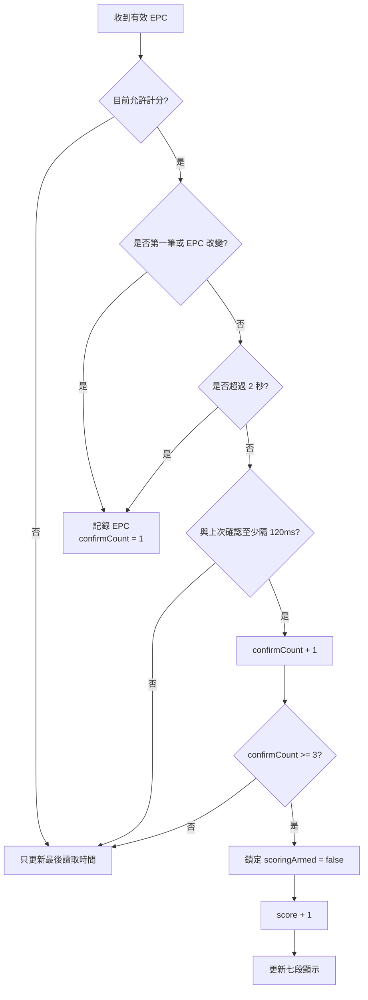
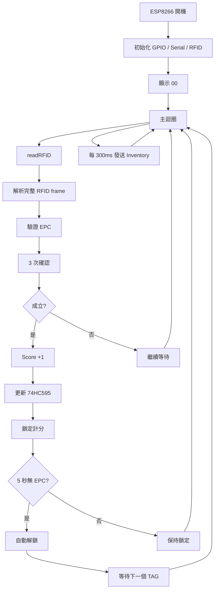

# ESP8266 + YPD-R200 RFID 自動計分韌體

此程式用於「無人機足球自動計分系統」的 ESP8266 韌體。

系統功能：

- ESP8266 透過 UART 與 YPD-R200 UHF RFID 讀寫器通訊。
- 每 300 ms 發送一次 RFID 單次盤點（Inventory）指令。
- 驗證 YPD-R200 回傳封包的 Header、End、Payload 長度與 Checksum。
- 解析 RFID EPC。
- 同一 EPC 在 2 秒內至少有效讀取 3 次，才判定為有效進球。
- 計分成功後立即鎖定，避免同一架無人機停在感應區造成連續加分。
- 連續 5 秒沒有再讀到有效 EPC 後，自動解除鎖定。
- 分數範圍 00～99。
- ESP8266 透過 74HC595 將兩位 BCD 分數送到 PCB 七段顯示電路。
- USB Serial 支援 `R`、`C`、`S` 測試指令。

---

## 1. 建議 GitHub 目錄

```text
Drone-Soccer-Auto-Scoring/
└─ firmware/
   ├─ esp8266_ir_test/
   │  ├─ README.md
   │  └─ esp8266_ir_test.ino
   │
   └─ esp8266_rfid_score/
      ├─ README.md
      └─ esp8266_rfid_score.ino
```

建議不要覆蓋原本 `esp8266_ir_test`，保留它當作早期硬體測試紀錄，再建立新的 `esp8266_rfid_score`。

---

## 2. 系統架構

```text
RFID TAG
   │
   ▼
YPD-R200 UHF RFID Reader
   │  UART
   ▼
ESP8266
   │
   ├─ RFID 封包驗證
   ├─ EPC 解析
   ├─ 3 次確認
   ├─ 防重複計分鎖定
   └─ 分數管理
          │
          ▼
      74HC595
          │
          ▼
   BCD 解碼 / 驅動電路
          │
          ▼
      4 吋七段顯示器
```

---

## 3. ESP8266 接腳定義

### PCB 七段顯示器

| ESP8266 | GPIO | PCB 訊號 | 功能 |
|---|---:|---|---|
| D5 | GPIO14 | DATA / DA | 74HC595 Serial Data |
| D6 | GPIO12 | CLOCK / CLK | 74HC595 Shift Clock |
| D0 | GPIO16 | LATCH | 74HC595 Latch Clock |
| GND | - | GND | 共地 |

程式：

```cpp
const uint8_t DATA_PIN  = D5;
const uint8_t CLOCK_PIN = D6;
const uint8_t LATCH_PIN = D0;
```

---

## 4. ESP8266 ↔ YPD-R200 接線

UART 必須「交叉接」。

| ESP8266 | YPD-R200 | 說明 |
|---|---|---|
| D7 / GPIO13 / RX | TXD | RFID → ESP8266 |
| D2 / GPIO4 / TX | RXD | ESP8266 → RFID |
| GND | GND | 一定要共地 |
| 5V 電源 | VCC / 5V | 供 YPD-R200 使用 |

程式：

```cpp
const uint8_t RFID_RX_PIN = D7;
const uint8_t RFID_TX_PIN = D2;

SoftwareSerial rfid(RFID_RX_PIN, RFID_TX_PIN);
```

### 電壓注意

YPD-R200 模組供電規格為約 3.6～5.5V，因此可以使用穩定 5V 電源供電。

ESP8266 GPIO 為 3.3V 邏輯，不應直接承受未確認的 5V UART 訊號。

最安全做法：

```text
YPD-R200 TXD
     │
     ▼
電平轉換 / 分壓
     │
     ▼
ESP8266 D7 (RX)
```

ESP8266 D2(TX) → YPD-R200 RXD 通常可先以 3.3V UART 測試；若模組無法穩定辨識，再依實際介面電平配置 level shifter。

---

## 5. YPD-R200 UART 參數

目前程式使用：

```cpp
rfid.begin(115200);
```

UART 設定：

```text
Baud rate : 115200 bps
Data bits : 8
Stop bits : 1
Parity    : None
Flow ctrl : None
```

> 注意：ESP8266 的 `SoftwareSerial` 在 115200 bps 時對配線、CPU 負載與時序較敏感。
> 如果 `INVALID FRAMES` 持續增加，可優先檢查 UART 接線、共地、供電與 SoftwareSerial 的穩定性。

---

## 6. RFID 單次盤點指令

程式每 300 ms 呼叫：

```cpp
requestRFID();
```

發送：

```text
AA 00 22 00 00 22 DD
```

欄位意義：

| Byte | 內容 |
|---|---|
| `AA` | Header |
| `00` | Command frame |
| `22` | Single Inventory command |
| `00 00` | Payload length = 0 |
| `22` | Checksum |
| `DD` | End |

---

## 7. RFID 回傳封包處理

`readRFID()` 負責逐 byte 收資料。

演算法：

1. 等待 `0xAA`。
2. 收到前 5 bytes 後，取得 Payload Length。
3. 計算完整封包長度：
   `total = payloadLength + 7`
4. 等待完整封包。
5. 呼叫 `processFrame()`。

若一個未完成的封包超過 100 ms 沒有收到後續資料，視為錯誤並清空 Buffer。

---

## 8. 封包驗證演算法

`processFrame()` 依序檢查：

```text
Header == 0xAA
        │
        ▼
End == 0xDD
        │
        ▼
Payload Length 正確
        │
        ▼
Checksum 正確
        │
        ▼
Type == 0x02
Command == 0x22
        │
        ▼
解析 RSSI / PC / EPC / CRC
        │
        ▼
驗證 PC 內 EPC 長度
        │
        ▼
EPC 轉為 HEX 字串
```

Checksum 計算範圍為：

```text
Type → Payload 最後一個 byte
```

只保留累加結果最低 8 bit。

---

## 9. EPC 長度檢查

通知封包 Payload：

```text
RSSI(1) + PC(2) + EPC(N) + CRC(2)
```

所以：

```cpp
uint16_t epcBytes = len - 5;
```

接著由 PC 的 EPC Length 欄位計算理論 EPC 長度：

```cpp
uint16_t expectedEpcBytes =
    ((pc >> 11) & 0x1F) * 2;
```

只有：

```text
expectedEpcBytes == epcBytes
```

才接受此 EPC。

---

## 10. 防誤判：3 次確認演算法

系統不是「讀到一次就加分」。

參數：

```cpp
REQUIRED_READS = 3;
CONFIRM_MS = 2000;
MIN_CONFIRM_GAP_MS = 120;
```

流程：



目的：

- 避免雜訊造成一次讀取就誤判。
- 避免相同封包瞬間重複被計算。
- EPC 改變時重新確認新的標籤。

---

## 11. 防止同一 TAG 重複加分

加分成功後：

```cpp
scoringArmed = false;
```

即使 RFID 繼續讀到同一個 TAG：

```cpp
if (!scoringArmed) {
    return;
}
```

也不會再次加分。

---

## 12. TAG 離開後自動重新解鎖

每次收到有效 EPC：

```cpp
lastValidSeen = millis();
```

若已經鎖定，並且連續 5 秒沒有再讀到有效 EPC：

```cpp
if (now - lastValidSeen >= 5000)
```

系統執行：

```cpp
scoringArmed = true;
```

重新等待下一次進球。

流程：

```text
TAG 進入
   ↓
確認 3 次
   ↓
+1 分
   ↓
LOCK
   ↓
TAG 還在 → 不再加分
   ↓
5 秒沒有 EPC
   ↓
AUTO REARM
   ↓
可以再次計分
```

---

## 13. 七段顯示器資料演算法

例如：

```text
score = 27
```

程式先拆成：

```cpp
tens = 2;
ones = 7;
```

組成一個 byte：

```cpp
data = (tens << 4) | ones;
```

結果：

```text
0010 0111
^^^^ ^^^^
十位 個位
```

使用：

```cpp
shiftOut(DATA_PIN, CLOCK_PIN, MSBFIRST, data);
```

因此可把 8 bit 理解成：

```text
Q7 Q6 Q5 Q4 | Q3 Q2 Q1 Q0
 D  C  B  A |  D  C  B  A
   十位數   |    個位數
```

也就是：

```text
Q7~Q4 → 十位 BCD
Q3~Q0 → 個位 BCD
```

再交由 PCB 上兩組 BCD-to-7-segment 解碼/驅動電路控制兩位七段顯示器。

---

## 14. Serial Monitor 指令

鮑率：

```text
115200
```

### R — 手動解除鎖定

```text
R
```

如果最近 3 秒仍有 TAG 被偵測，會拒絕解除鎖定。

### C — 分數歸零

```text
C
```

顯示器立即回到：

```text
00
```

但不改變目前 RFID 的鎖定狀態。

### S — 顯示系統狀態

```text
S
```

會顯示：

```text
SCORE
ARMED
VALID FRAMES
INVALID FRAMES
LAST TAG SEEN
```

---

## 15. 完整主程式流程



---

## 16. 建議實際接線

### ESP8266 → PCB

```text
ESP8266 D5 / GPIO14 ───── PCB DATA / DA
ESP8266 D6 / GPIO12 ───── PCB CLOCK / CLK
ESP8266 D0 / GPIO16 ───── PCB LATCH
ESP8266 GND         ───── PCB GND
```

### ESP8266 → YPD-R200

```text
ESP8266 D7 / GPIO13 (RX) ◄──── YPD-R200 TXD
ESP8266 D2 / GPIO4  (TX) ────► YPD-R200 RXD
ESP8266 GND                ──── YPD-R200 GND
5V Power                   ──── YPD-R200 VCC
```

### 系統共地

```text
ESP8266 GND
     │
     ├──── PCB GND
     │
     └──── YPD-R200 GND
```

三者一定要共地，否則 UART 與 74HC595 控制訊號可能不穩定。

---

## 17. 測試順序

建議依序測試：

1. ESP8266 單獨控制 PCB，確認 `00 → 99` 顯示正常。
2. ESP8266 只接 YPD-R200，Serial Monitor 確認能讀出 EPC。
3. 輸入 `S`，確認 `VALID FRAMES` 會增加。
4. TAG 保持在天線前，確認只加 1 分。
5. TAG 移開至少 5 秒，確認出現：

```text
AUTO REARMED
READY FOR NEXT TAG
```

6. 再把 TAG 放回，確認可再加 1 分。
7. 最後再同時接 PCB 顯示器與 RFID，完成整機測試。

---

## 18. 常見除錯

### 一直沒有讀到 EPC

檢查：

- TX/RX 是否交叉。
- ESP8266、RFID 是否共地。
- YPD-R200 是否有穩定 5V。
- Serial baud 是否為 115200。
- 天線是否接好。

### `INVALID FRAMES` 很多

檢查：

- UART 線太長。
- SoftwareSerial 115200 不穩定。
- 電源雜訊。
- TXD 電壓是否適合 ESP8266。
- GND 是否可靠。

### TAG 一直重複加分

正常程式下，加分後應看到：

```text
TAG LOCKED
WAITING FOR TAG EXIT...
```

若仍重複加分，檢查是否有其他地方把 `scoringArmed` 設回 `true`。

---

## 19. 目前核心參數

| 參數 | 值 | 功能 |
|---|---:|---|
| `RFID_POLL_MS` | 300 ms | RFID 輪詢週期 |
| `CONFIRM_MS` | 2000 ms | 3 次確認時間窗 |
| `MIN_CONFIRM_GAP_MS` | 120 ms | 有效確認最小間隔 |
| `REQUIRED_READS` | 3 | EPC 必須確認次數 |
| `AUTO_REARM_MS` | 5000 ms | TAG 離開後自動解鎖 |
| `MANUAL_REARM_MS` | 3000 ms | 手動解鎖安全等待 |
| `MAX_FRAME` | 96 bytes | UART frame buffer |
| `score` | 0～99 | 計分範圍 |

---

## 20. 專題演算法摘要

本系統採用「RFID 多次確認 + 狀態鎖定」的自動計分演算法。ESP8266 週期性向 YPD-R200 發送 EPC Inventory 指令，在接收到 RFID 回傳資料後，先進行封包格式、資料長度與 Checksum 驗證，再解析 EPC。為避免單次讀取雜訊造成誤判，同一 EPC 必須在限定時間內連續通過三次有效確認才視為一次有效進球。計分完成後系統進入鎖定狀態，即使標籤仍停留在感應範圍內也不會再次加分；當系統連續五秒沒有接收到有效 EPC 時，再自動解除鎖定並等待下一次進球。分數則轉換為兩組 BCD 資料，透過 74HC595 傳送至 PCB 上的七段顯示解碼與驅動電路，完成 00～99 的即時分數顯示。
